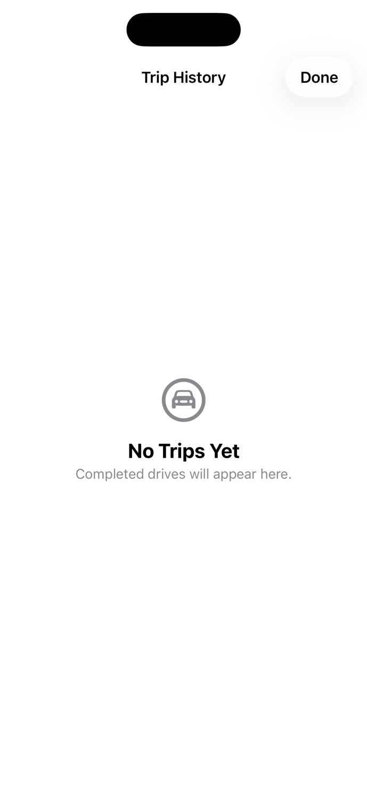

# Trips & history

Trip history stores all your saved drives and lets you review, organize, and export them.

## Trip history list

The history list shows all saved drives in reverse chronological order, grouped by month. Each row shows the drive's name (or date if unnamed), distance, duration, and date.

Tap a drive to open its full summary.

## Drive summary

The drive summary screen presents all recorded data for a drive in collapsible sections:

| Section | Contents |
|---------|----------|
| Route map | Interactive map with the full GPS track |
| Overview | Distance, elapsed time, moving time, stopped time, average speed, and max speed |
| Speed profile | Speed over time with an interactive scrub bar |
| Elevation profile | Altitude over time with gain, loss, min/max, and net change |
| Vertical speed | Climb and descent rates over time |
| G-Force | Peak G-force reading and a 32×32 heat map of acceleration events |
| GPS | Best and worst horizontal accuracy recorded during the drive |

Scrubbing on any of the three profile charts (speed, elevation, vertical speed) moves all three in sync, so you can see how all three measurements relate at any moment.

## Naming drives

You can name a drive on the Drive Complete screen immediately after stopping, or later by tapping the drive in history and editing its name at the top of the summary screen. Unnamed drives are listed by date and time.

## Trip groups

Related drives can be grouped into a **trip** — for example, the outbound and return legs of a road trip, or multiple driving sessions in the same area.

Select two or more drives in history using long-press, then tap **Group**. Give the group a name. Grouped drives remain individually accessible; the group provides a combined view.

## Exporting drives

Open a drive summary and tap the **export icon** in the bottom bar. Choose the format:

### CSV

A plain-text file containing every GPS sample recorded during the drive, one row per sample.

**Columns:** `timestamp`, `latitude`, `longitude`, `altitude_m`, `speed_ms`, `course_deg`, `horizontal_accuracy_m`, `vertical_accuracy_m`

- Timestamps are ISO 8601 with fractional seconds (UTC)
- Latitude and longitude are in decimal degrees (7 decimal places)
- Altitude and vertical accuracy are omitted when the GPS system reports an invalid vertical fix
- Speed is in meters per second (non-negative)
- Course is in degrees from true north (omitted when unavailable)
- Horizontal accuracy is in meters

The CSV is suitable for import into spreadsheet applications, Python/pandas, or any tool that accepts delimited GPS data.

### GPX

A GPX 1.1 file with Garmin TrackPointExtension v2 extensions. This format is compatible with Garmin Connect, Strava, Komoot, and most GPS-aware mapping applications.

Each recording segment within the drive is exported as a separate `<trkseg>` element within a single `<trk>`. This means that if you paused and resumed a drive, the gap between segments is represented accurately rather than drawn as a straight line connecting distant points.

Each track point includes:
- Latitude and longitude (7 decimal places)
- Elevation in meters (when the GPS vertical fix is valid)
- Timestamp (ISO 8601, UTC)
- Speed in meters per second (as a `<gpxtpx:speed>` extension)
- Course in degrees (as a `<gpxtpx:course>` extension, when available)

### Exporting a trip group

Open a trip group and tap the export icon to export a **combined GPX** containing one `<trk>` per drive, in chronological order. Drives are kept as separate tracks — they are not concatenated — so gaps between separate drive sessions are not misrepresented.

### Filenames

Exported files are named using the drive's local start time and name: `YYYY-MM-DD_HHMM_drive-name.csv` (or `.gpx`). Unnamed drives use just the date and time.

## Deleting drives

Swipe a drive row in history to reveal the delete option, or open the summary and tap **Delete**. Deleting a drive removes it permanently. If the drive belongs to a trip group, it is also removed from the group.
