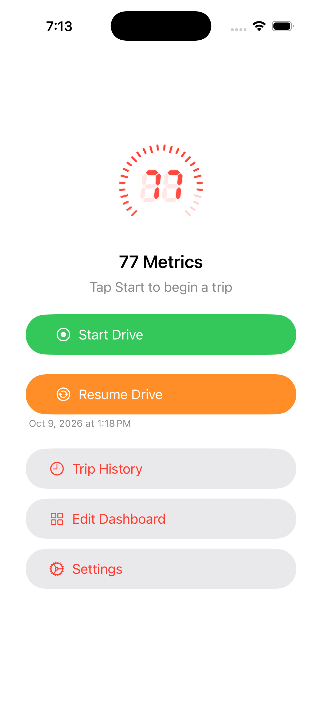
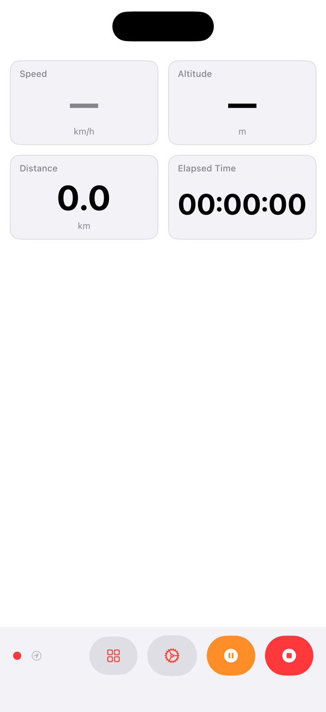
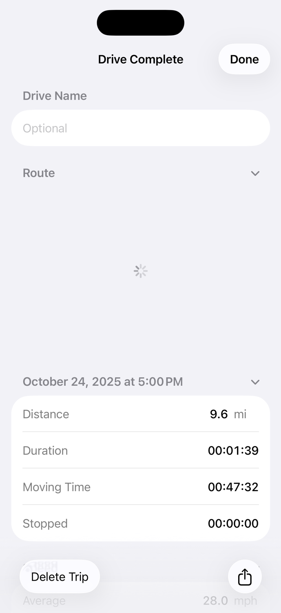

# Your first drive

This guide walks you from first launch through a complete drive and back to the idle screen with a saved record.

---

## Step 1 — Grant location permission

77 Metrics needs location access to track your position, speed, and elevation. On the very first launch, iOS presents a permission prompt.

Choose one of the following:

| Option | What it enables |
|--------|----------------|
| **Allow While Using App** | Location tracking when 77 Metrics is in the foreground |
| **Allow Always** | Location tracking continues if 77 Metrics moves to the background during a drive |

**Allow Always** is recommended if you want the drive to keep recording if you receive a phone call or use another app briefly.

If you dismissed the prompt without choosing, or want to change your selection:

1. Open the iPhone **Settings** app
2. Tap **Privacy & Security → Location Services → 77 Metrics**
3. Select **While Using the App** or **Always**

If a yellow warning card appears on the 77 Metrics idle screen, location access is either not granted or set to "Never." Follow the steps above to fix it.

---

## Step 2 — Start a drive

From the idle screen, tap **Start Drive**.

The screen switches to the active drive view. The dashboard tiles begin updating as GPS data arrives — this usually takes a few seconds. While GPS is acquiring a fix, most tiles show a dash (—). This is normal.

> **Note about the dash:** A dash means the metric is not yet available, not that something is broken. Speed, altitude, and direction all require an active GPS fix. Elevation gain and max speed need a moment of driving before they have meaningful values.

If the idle screen shows a **Resume Drive** button alongside **Start Drive**, tapping **Resume Drive** continues your most recently saved drive as a new segment instead of starting a fresh one. See [Drives](../features/drives.md) for details.

---

## Step 3 — Understand the active drive screen

### The dashboard

The dashboard fills most of the screen with metric tiles. Each tile shows one metric — current speed, elapsed time, altitude, and so on. Swipe left or right to move between dashboard pages if you have set up more than one.

Tile values update continuously. The first ten seconds of a drive may be slightly noisier for elevation and grade as the barometric and GPS sensors converge.

### Status indicators

A slim status bar runs along the bottom of the screen in portrait, or on the right side in landscape:

| Indicator | Meaning |
|-----------|---------|
| Red dot | Drive is recording |
| Orange dot + "P" | Drive is paused |
| GPS icon (filled) | Strong GPS signal |
| GPS icon (half-filled) | Moderate signal |
| GPS icon (slashed) | Weak signal or no fix |
| Yellow triangle | Drive checkpoint could not be saved to disk |

### Controls

The controls sit alongside the status indicator:

- **Pause** — suspends the drive (see Step 4)
- **Stop** — ends the drive and opens the Drive Complete screen (see Step 5)
- **Edit Dashboard** — opens the dashboard edit view without stopping
- **Settings** — opens settings without stopping

---

## Step 4 — Pause and resume (optional)

Tap **Pause** to suspend recording. While paused:

- Elapsed time stops counting
- Distance, elevation, and G-force stop accumulating
- GPS keeps running so the signal is ready the moment you resume
- Drive data is saved to disk immediately

Tap **Resume** to pick up where you left off. The gap between pause and resume is excluded from elapsed time, moving time, and stopped time.

You can pause and resume as many times as you need. The drive is not complete until you tap **Stop**.

---

## Step 5 — Stop the drive

Tap **Stop**. The drive ends, all sensors stop, and the **Drive Complete** screen slides up.

### What the Drive Complete screen shows

The Drive Complete screen has several collapsible sections:

| Section | Contents |
|---------|----------|
| Route map | Your GPS track drawn on a map |
| Overview | Distance, duration, moving time, stopped time |
| Speed profile | Average, moving average, and max speed; an interactive chart you can scrub |
| Elevation profile | Gain, loss, min/max elevation, net change; an interactive chart |
| Vertical speed | Max climb and descent rates; an interactive chart |
| G-Force | Peak G-force and a heat map (appears only if G-force data was recorded) |
| GPS | Best and worst horizontal accuracy during the drive |

Tap any section header to expand or collapse it. Drag on any of the three profile charts to scrub through the drive — all three charts move together.

### Name, save, or discard

At the top of the Drive Complete screen is a text field for an optional name. It is focused automatically when the screen appears.

- Type a name, or leave it blank — unnamed drives are listed by date and time in history
- Tap **Done** (top right) to save the drive to Trip History
- Tap **Delete Trip** (bottom left) and confirm to discard it without saving

The drive is not saved until you tap **Done**. If the app closes before you do, the drive data is preserved as a checkpoint and can be recovered on next launch.

---

## Step 6 — Find your saved drive

After tapping **Done**, the Drive Complete screen closes and you return to the idle screen. Your drive is now in Trip History.

Tap **Trip History** on the idle screen. Your drive appears at the top of the list, under the current month. Tap it to reopen the Drive Complete screen and review all the data.

From Trip History you can also:

- **Rename** a drive by opening it and editing the name field, then tapping **Done**
- **Delete** a drive by swiping left on its row and confirming
- **Export** a drive as CSV or GPX by opening it and tapping the export icon in the bottom bar

---

## Common first-drive questions

**Why is my speed showing 0 or a dash at the start?**
GPS takes a few seconds to acquire a fix, especially indoors or in dense areas. Move to open sky and wait up to 30 seconds.

**Why does altitude seem to jump at the start?**
77 Metrics fuses barometric and GPS altitude. There is a brief stabilization period (up to 10 seconds) while the two sources align. The elevation profile tile shows "Stabilizing altitude…" during this window.

**What if I close the app mid-drive?**
Your data is checkpointed approximately every 30 seconds. When you next open 77 Metrics, a recovery card appears with the interrupted drive's date and distance. Tap it to open the Drive Complete screen and save normally, or discard it.

---

*Next: [Dashboard customization](dashboard-customization.md) — choose your metrics and arrange your layout.*
